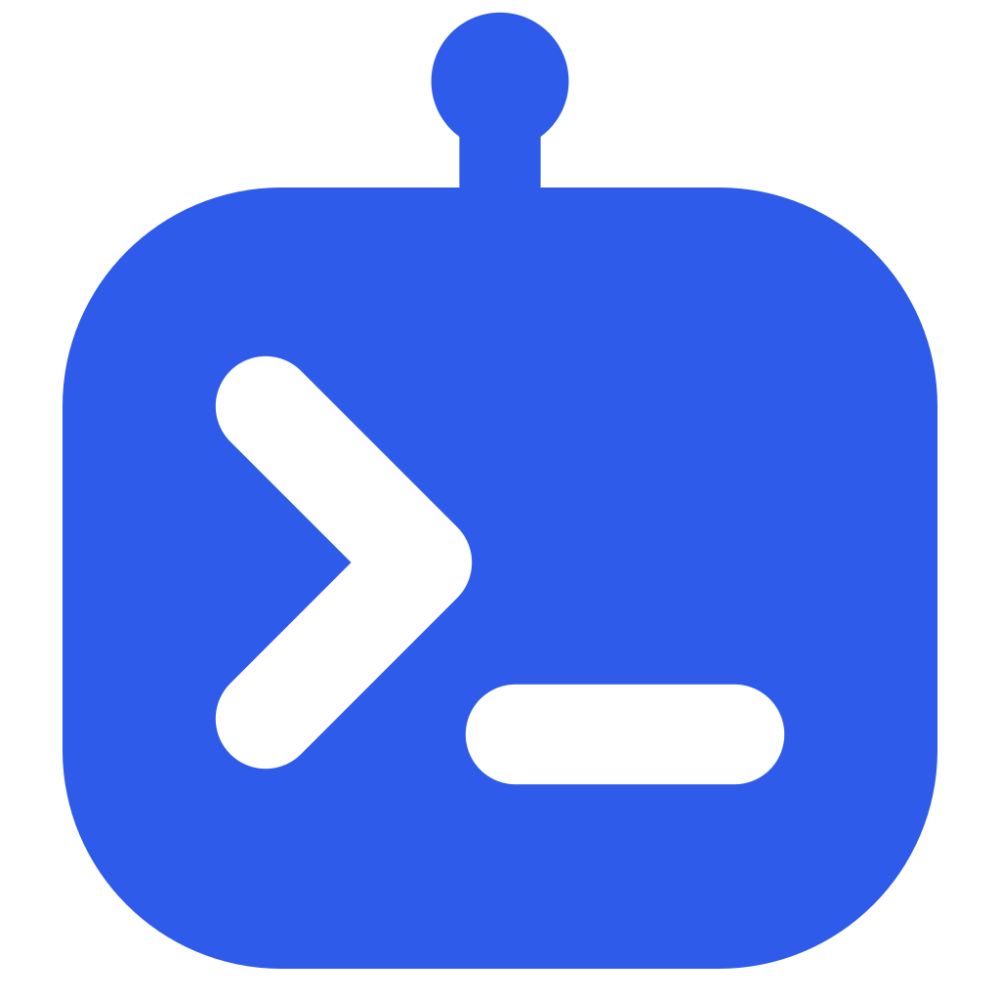
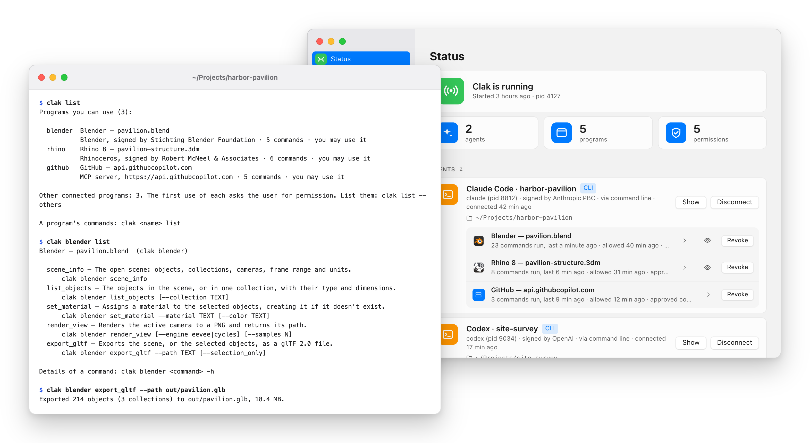
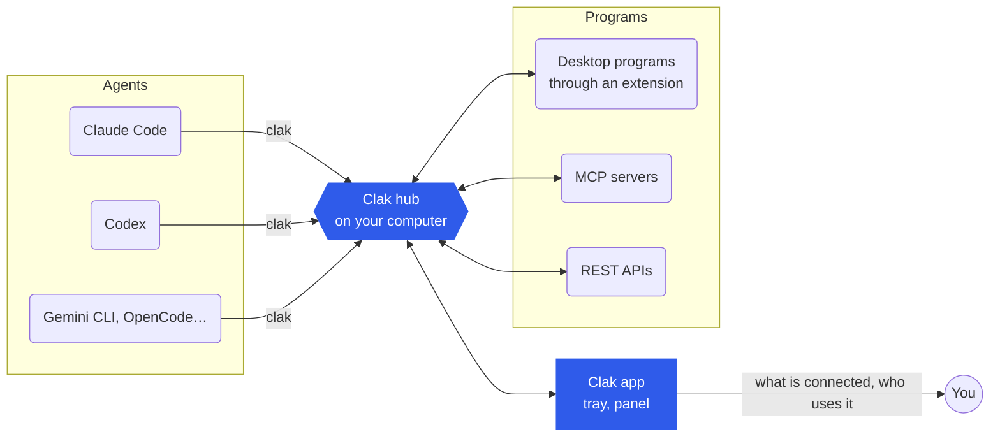
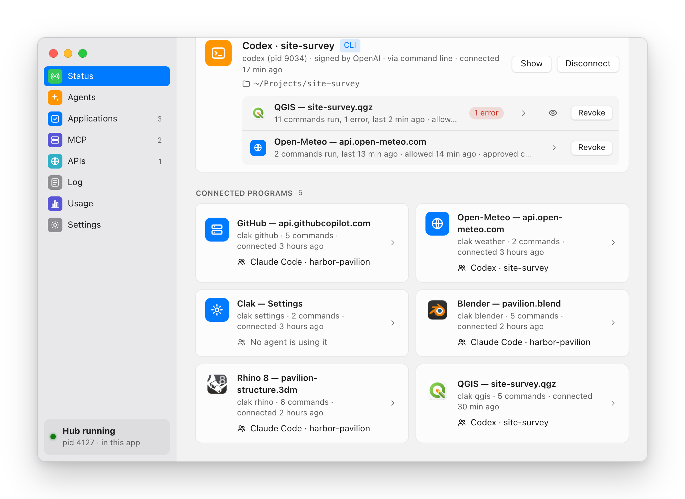
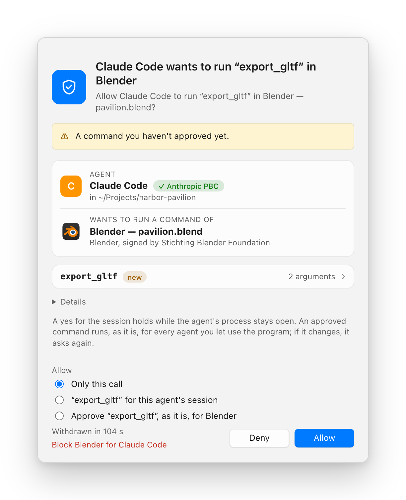

<p align="center">
  
</p>

<h1 align="center">Clak</h1>

<p align="center">
  <strong>Let the AI agents on your computer use your programs.</strong><br>
  Claude Code, Codex, Gemini CLI, OpenCode… work with what is open in your desktop programs, with your MCP servers and your REST APIs, all from one command line.
</p>

<p align="center">
  <a href="https://github.com/giancarlov93/clak/releases/latest"></a>
  <a href="https://github.com/giancarlov93/clak/actions/workflows/release.yml"></a>
  <a href="https://github.com/giancarlov93/clak/releases"></a>
  
  <a href="LICENSE"></a>
  <br>
  <a href="rust-toolchain.toml"></a>
  
  
  <a href="https://github.com/giancarlov93/clak/commits/main"></a>
</p>

<p align="center">
  <a href="#install"><strong>Install</strong></a> ·
  <a href="#how-it-works"><strong>How it works</strong></a> ·
  <a href="docs/extensions.md"><strong>Write an extension</strong></a> ·
  <a href="docs/protocol.md"><strong>Protocol</strong></a> ·
  <a href="CHANGELOG.md"><strong>Changelog</strong></a>
</p>

<br>

<picture>
  <source media="(prefers-color-scheme: dark)" srcset="docs/images/hero-dark.png">
  
</picture>

<sub>The pictures show example data: the agents, programs and files are made up.</sub>

## What it does

<table>
  <tr>
    <td width="50%" valign="top">
      <h3>🧩 Your programs, as they are right now</h3>
      An open program connects to Clak and offers the commands that fit its state: what is
      open, what is selected, what can be done right now. The agent works on the file you
      have open, not on a copy.
    </td>
    <td width="50%" valign="top">
      <h3>⌨️ One command line for everything</h3>
      <code>clak list</code> shows what an agent can use, <code>clak &lt;program&gt; -h</code>
      its commands, and the calls compose in scripts and pipes: what would take an agent
      several MCP turns takes one command line, without filling its context. Clak installs a
      skill that teaches agents this.
    </td>
  </tr>
  <tr>
    <td width="50%" valign="top">
      <h3>🔌 MCP servers and REST APIs too</h3>
      MCP servers over HTTP, with a token or OAuth, or local ones over stdio; REST APIs from
      their OpenAPI description or by hand. Once connected they are programs like the others,
      under a name of your choice: <code>clak github</code>, <code>clak weather</code>.
    </td>
    <td width="50%" valign="top">
      <h3>🚀 Agents ready to work</h3>
      Launch an agent in a folder with the programs it needs already at hand (presets), find
      its past conversations again, and see what its tokens would cost at the API's prices.
      Agents that only speak MCP reach the same programs through <code>clak-shim</code>.
    </td>
  </tr>
  <tr>
    <td width="50%" valign="top">
      <h3>👀 Everything in view</h3>
      The panel shows which programs are connected, which agent is using which, and every
      command they run, with its result and how long it took.
    </td>
    <td width="50%" valign="top">
      <h3>🖥️ At home on each system</h3>
      In the Windows tray and the Mac menu bar, with the system's notifications, Mica on
      Windows 11 and glass on the Mac. On Linux, for servers and containers,
      <a href="docs/linux.md">the hub without an interface</a>.
    </td>
  </tr>
</table>

## How it works



1. **A program connects** to the Clak hub on your computer and offers its commands. MCP
   servers and REST APIs are connected from the panel.
2. **An agent finds them** with `clak list`, and reads a program's commands with
   `clak <program> -h`.
3. **It runs a command**: the command runs in the program, and its result comes back on the
   agent's command line, ready for the next one.
4. **You follow it in the panel**: who is using what, every call, what it costs.

The first time an agent uses a program, Clak asks you; who is asking is read from the system,
not from what the agent says. The hub listens on loopback only, behind a token, and keeps
secrets in the keychain on the Mac and with DPAPI on Windows.

## Screenshots

<table>
  <tr>
    <td width="58%" valign="top">
      <picture>
        <source media="(prefers-color-scheme: dark)" srcset="docs/images/programs-dark.png">
        
      </picture>
    </td>
    <td width="42%" valign="top">
      <picture>
        <source media="(prefers-color-scheme: dark)" srcset="docs/images/consent-dark.png">
        
      </picture>
    </td>
  </tr>
  <tr>
    <td align="center"><sub><b>The panel</b>: what is connected and who is using it</sub></td>
    <td align="center"><sub><b>A question</b>: an agent's first call to a new command</sub></td>
  </tr>
</table>

## Install

<table>
  <tr>
    <th>Windows</th>
    <th>macOS</th>
    <th>Linux</th>
  </tr>
  <tr>
    <td valign="top">x64 installer, per user, without administrator rights<br><code>Clak_&lt;version&gt;_x64-setup.exe</code></td>
    <td valign="top">Apple silicon, signed with a Developer ID and notarized<br><code>Clak_&lt;version&gt;_aarch64.dmg</code></td>
    <td valign="top">x64 and ARM, linked statically: <code>clak</code>, <code>clak-shim</code> and <code>clak-daemon</code><br><code>clak_&lt;version&gt;_linux_x64.tar.gz</code></td>
  </tr>
</table>

<p align="center">
  <a href="https://github.com/giancarlov93/clak/releases/latest"></a>
</p>

The app sets up what the agents need: the skill that teaches them `clak`, `clak` in the PATH,
the MCP clients, the start with the system. Then it keeps itself up to date. On Linux the questions are answered on a web page or in the daemon's
terminal: see [Clak on Linux](docs/linux.md).

## Extensions

A desktop program joins Clak through an extension, which connects over a WebSocket on
loopback and offers its commands.

- [Writing an extension](docs/extensions.md): the guide, with the same minimal extension in
  [Python, JavaScript and C#](examples/), and in Rust with `clak-kit`.
- [The Clak extension protocol](docs/protocol.md): every message.

The protocol version is `clak_wire::PROTOCOL`. It changes only when an extension written for
the previous one would stop working, and the specification changes with it.

## Documentation

| | |
| --- | --- |
| [Writing an extension](docs/extensions.md) | Connect a program to Clak, with examples in four languages |
| [The extension protocol](docs/protocol.md) | Every message between a program and the hub |
| [Clak on Linux](docs/linux.md) | The hub without an interface, for servers and containers |
| [Developing Clak](docs/development.md) | The crates, building, CI, packaging and releases |
| [Changelog](CHANGELOG.md) | What changes from one version to the next |

## Building

The Rust version is fixed in `rust-toolchain.toml`.

```bash
cargo build
cargo test
cargo build -p clak-app    # the app, with Tauri: not among the default members
```

The crates, the checks of CI, trying Clak without touching your own, and the release are in
[Developing Clak](docs/development.md).

## License

MIT: see [LICENSE](LICENSE). The dependencies' notices are written by `scripts/notices.mjs` for
every installer and go next to the app as `THIRD-PARTY-NOTICES.txt`, with `LICENSE.txt`; in
the Linux archives, next to the binaries.

<br>

<p align="center">
  <br>
  <sub>Made with Rust and Tauri, for Windows, macOS and Linux.</sub>
</p>
