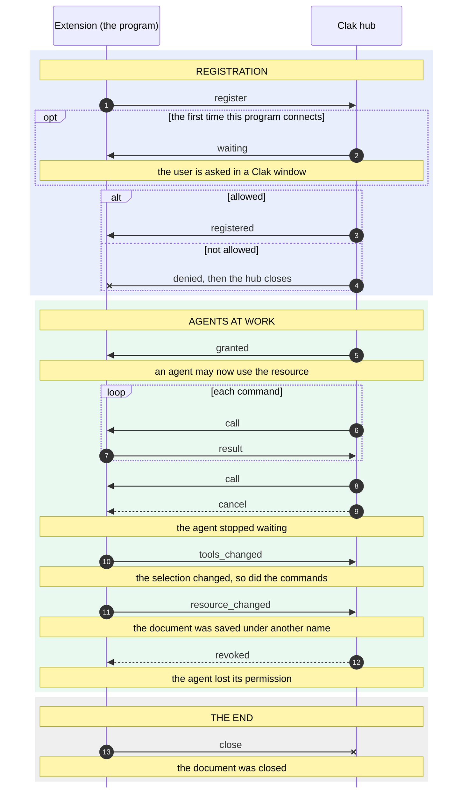

# The Clak extension protocol

Version **1**.

This document specifies how a program on the user's computer connects to Clak so that AI
agents can use it. It is everything an extension needs: you can write one in any language
that has a WebSocket client and a JSON parser. For a guided introduction with complete
examples, read [Writing an extension](extensions.md) first.

## Overview

Clak runs a *hub* on the user's computer. Programs connect to it and offer *commands*;
AI agents (Claude Code, Codex, Cursor and others) find them with the `clak` command line
and call them. The hub sits in the middle and asks the user before anything happens:

- before a program can connect at all (once per executable, remembered);
- before each agent can use a program (once per agent and per open program).

The program never decides who may use it: it is told (`granted`, `revoked`).

A connection represents one **live resource**, not an application: a document, a scene,
a project that is open right now. A program with three documents open makes three
connections. When the document closes, the connection closes, and every permission given
for it ends.

| Term | Meaning |
| --- | --- |
| hub | The Clak process that the program connects to. |
| extension, program | The software that connects and offers commands. |
| resource | What one connection represents: one opening of one document. |
| tool, command | Something an agent can call, with a name, a description and a JSON Schema for its arguments. |
| agent, harness | An AI agent running on the same computer, using the `clak` command line. |
| grant | The permission one agent has to use one resource. |

## 1. Finding the hub

The hub keeps its files in a folder called its *home*:

- the folder named by the `CLAK_HOME` environment variable, if it is set and not empty;
- otherwise `.clak` in the user's home folder (`%USERPROFILE%\.clak` on Windows,
  `~/.clak` on macOS).

While the hub runs, the home contains `daemon.json`. On the Mac only the user can read it; on
Windows it has the access rules of the folder it is in, which in the user's profile are the
user's own:

```json
{
  "ws_port": 61969,
  "token": "3f1c9a…",
  "control": "…",
  "pid": 12345,
  "protocol": 1
}
```

| Field | Meaning |
| --- | --- |
| `ws_port` | The loopback port to connect to. It changes every time the hub starts. |
| `token` | The secret to send in `register`. It changes every time the hub starts. |
| `protocol` | The protocol version the hub speaks. Absent means `1`. |
| `control`, `pid` | Used by the `clak` command line; extensions ignore them. |

Read the file each time you connect, never cache it. If it is missing, Clak is not
running: tell the user to open it. If the connection is refused, the file was left behind
by a hub that is no longer running: treat it the same way.

If `protocol` is a version your extension doesn't speak, don't connect: tell the user
that either Clak or the extension needs updating.

## 2. Connecting

Open a WebSocket ([RFC 6455](https://www.rfc-editor.org/rfc/rfc6455)) to
`ws://127.0.0.1:<ws_port>/`. No subprotocol, no extra headers, no TLS: the connection never
leaves the computer.

- Every message is one JSON object, sent as a UTF-8 text frame. Binary frames carrying the
  same JSON are accepted too.
- A message is at most 16 MiB.
- The WebSocket handshake must complete within 10 seconds.
- The hub sends a ping every 20 seconds. Answer with a pong, as WebSocket libraries do on
  their own.
- Anything that is not a JSON object, or an object with a repeated key, closes the connection.
- Every message has a `type`. Ignore fields you don't know and message types you don't
  know: future versions of the hub may add them without changing the protocol version.

## 3. A session



## 4. Messages from the extension

### `register`

The first message on every connection, sent once: what comes before it is ignored, what comes
after it is read once it is accepted.

```json
{
  "type": "register",
  "protocol": 1,
  "token": "3f1c9a…",
  "resource": {
    "app": "Notes",
    "title": "shopping.txt",
    "instance_id": "9b2e4c1d0f6a4e8b",
    "publisher": "Example Ltd"
  },
  "tools": [
    {
      "name": "append",
      "description": "Adds a line at the end of the note.",
      "input_schema": {
        "type": "object",
        "properties": {"line": {"type": "string", "description": "The line to add."}},
        "required": ["line"]
      }
    }
  ],
  "active": ["append"],
  "instructions": "Call read before append, to see what is already there."
}
```

| Field | Required | Meaning |
| --- | --- | --- |
| `protocol` | no | The version the extension speaks. Absent means `1`. Always send it. |
| `token` | yes | The `token` from `daemon.json`. |
| `resource.app` | yes | The program's name, as the user knows it ("Blender", "QGIS"). Keep it stable: the user's consent is remembered for it, and the command-line name comes from it. |
| `resource.title` | yes | What is open: a file name, a project name. Shown to the user and to agents. |
| `resource.instance_id` | yes | A string unique to this opening, e.g. a random UUID. A document opened again is a new instance. |
| `resource.publisher` | no | Who made the extension. Shown to the user as a claim, not as a fact: what the user is told about the program comes from the operating system (section 8). |
| `tools` | yes | Every command the extension has (section 6). May be empty. |
| `active` | no | The names of the commands available right now. Absent means all of them. |
| `instructions` | no | How the program wants to be used, for everything its commands have in common (section 6). |

The hub answers with `registered`, or with `waiting` first if it must ask the user, or
with `denied` or `error` before closing the connection.

### `tools_changed`

The set of commands changed: a different selection, a different mode. It replaces the
whole list.

```json
{"type": "tools_changed", "tools": [ … ], "active": ["read"], "instructions": "…"}
```

`tools` is required and has the same form as in `register`; `active` works the same way, and
names in it that aren't among `tools` are ignored.
If `instructions` is present it replaces the previous instructions (an empty string
removes them); if it is absent they stay as they were.

### `resource_changed`

The same document has a new name: saved under another name, renamed. The hub shows the new
title to the user and to agents from now on; the grants stay.

```json
{"type": "resource_changed", "title": "groceries.txt"}
```

| Field | Required | Meaning |
| --- | --- | --- |
| `title` | yes | The new `resource.title`, as in `register`. |

A *different* document (the window now shows another file) is another opening: send `close`
and `register` it on a new connection, and agents ask again for it.

### `result`

The answer to a `call`.

```json
{"type": "result", "call_id": "call_83accd680467", "content": "added"}
```

```json
{"type": "result", "call_id": "call_83accd680467", "content": "“line” is missing", "is_error": true}
```

| Field | Required | Meaning |
| --- | --- | --- |
| `call_id` | yes | The `call_id` of the call being answered. |
| `content` | no | What the command returns (section 7). |
| `is_error` | no | `true` if the command failed; `content` then says why, in words the agent can act on. |

A result for a call that was cancelled, or that the hub doesn't know, is ignored. One without a
`call_id` is malformed.

### `close`

The resource is going away: the document was closed, the program is quitting.

```json
{"type": "close", "reason": "resource_closed"}
```

`reason` is optional and only informative. Close the WebSocket right after. Closing the
WebSocket without `close` has the same effect; the hub records it as `app_gone`. Either
way the resource disappears from the agents' list and every grant for it ends.

## 5. Messages from the hub

### `waiting`

```json
{"type": "waiting", "reason": "consent"}
```

The user is being asked whether this program may connect. Show it (for example
"Waiting for permission in Clak…"); the answer may take a while.

### `registered`

```json
{"type": "registered", "name": "notes", "protocol": 1}
```

The program is connected and agents can see it. `name` is how agents call it
(`clak notes append --line milk`): show it to the user. `protocol` is the version the hub
speaks.

### `denied`

```json
{"type": "denied", "reason": "user"}
```

The program may not connect, and the hub closes the connection. `reason` is `user` (the
user said no), `no_answer` (nobody answered within 120 seconds) or `no_prompt` (the hub has
no window to ask in). After a no, the same program connecting again within 60 seconds is
denied without asking. Don't reconnect on your own: wait for the user to try again.

### `granted`

```json
{"type": "granted", "grant_id": "grant_6fb2ce07232e", "harness": "Claude Code · shopping"}
```

An agent may now use the resource. `harness` names it for the user, as the agent and the folder
it works in: showing who is using the document is good practice.

### `revoked`

```json
{"type": "revoked", "grant_id": "grant_6fb2ce07232e", "reason": "user", "harness": "Claude Code · shopping"}
```

An agent can no longer use the resource: the user revoked it (`user`) or the agent's
process ended (`harness_gone`).

### `call`

```json
{
  "type": "call",
  "call_id": "call_83accd680467",
  "tool": "append",
  "arguments": {"line": "milk"},
  "harness": "Claude Code · shopping"
}
```

An agent with a grant calls a command, or the user does from Clak's panel (`harness` is then
`You, from Clak's panel`, with no `granted` before). Answer with exactly one `result` with the
same `call_id`. `arguments` is always an object. The hub only sends calls for commands that
are active; still, answer an unknown `tool` with an error result. Calls can overlap (section 9).

### `cancel`

```json
{"type": "cancel", "call_id": "call_83accd680467", "reason": "timeout"}
```

Nobody is waiting for that call any more: the agent gave up (`interrupted`) or the hub's
time limit passed (`timeout`). If the call hasn't started yet, don't run it; if it is
running and can be stopped, stop it. Otherwise an agent that retries would run the same
action twice. Any result you send for it is ignored.

### `error`

```json
{"type": "error", "error": "invalid token"}
```

Something the extension sent is wrong. The hub closes the connection after it.

| `error` | Cause |
| --- | --- |
| `invalid token` | The token is wrong or missing: read `daemon.json` again. |
| `unsupported protocol version: this Clak speaks version N` | The `protocol` in `register` isn't one the hub speaks. The message also carries `"protocol": N`. |
| `malformed message: …` | A required field is missing or has the wrong type, or a tool name is invalid or repeated. The text names the problem. |

## 6. Commands

Each command is an object:

| Field | Required | Meaning |
| --- | --- | --- |
| `name` | yes | 1 to 64 characters among `A-Z a-z 0-9 _ . -`, unique within the resource. |
| `description` | yes | What it does, for the agent. One or two sentences. |
| `input_schema` | no | A [JSON Schema](https://json-schema.org/) object for the arguments, with `"type": "object"`. Absent means no arguments. |

Agents pass arguments on the command line, and `clak` converts them using the schema:
`--line milk` becomes `{"line": "milk"}`, `--count 3` becomes `3` if `count` is an
integer, `--force` becomes `true`, and a value for an `object` or `array` property is read
as JSON. Give every property a `type` and a `description`, list the `required` ones, and
use `enum` and `default` where they apply: the agent sees all of it in `clak <name> -h`.

**Approval covers the exact text.** When a user lets an agent use a resource, the
permission covers each command's name, description and schema exactly as they were. A
command that is added or changed afterwards (even by a comma) needs that agent's
permission again, which the hub asks for the first time the agent calls it. Keep
descriptions stable; don't put changing data in them.

**Active commands.** `tools` lists everything the extension can do; `active` lists what
makes sense right now. A command that isn't active doesn't exist for agents and calling it
fails without disturbing the user. Switch commands on and off with `tools_changed` as the
user's selection or mode changes.

**Instructions.** `instructions` is free text shown before the commands in
`clak <name> -h`: the workflow ("call get_scene_summary first"), conventions, units. It
keeps the descriptions short. At most 4000 UTF-16 code units; longer text is cut and ends
with `…`.

**Names.** Agents call the program by a name the hub derives from `resource.app`: lower
case, accents removed, every run of other characters turned into one `-`, at most 24
characters ("Notion (work)" becomes `notion-work`). If the name is taken, `-2`, `-3`… is
added. `list`, `status`, `help`, `version` and `settings` are reserved and get an `app-`
prefix. The name is in `registered`.

## 7. Results

`content` can be:

- **text**, the most common form: `"content": "added"`;
- **a number or a boolean**: `"content": 42`;
- **any JSON value**: agents see it formatted as JSON;
- **a list of content blocks**, the same blocks as MCP, to return files and images:

```json
"content": [
  {"type": "text", "text": "The render is ready."},
  {"type": "image", "data": "iVBORw0KGgo…", "mimeType": "image/png"},
  {"type": "resource", "resource": {"uri": "file:///scene.blend", "mimeType": "application/x-blender", "blob": "QkxFTkRFUi…"}},
  {"type": "resource", "resource": {"uri": "file:///notes.md", "text": "# Notes"}}
]
```

| Block | Fields |
| --- | --- |
| `text` | `text` |
| `image`, `audio` | `data` (base64), `mimeType` |
| `resource` | `resource.uri`, and `resource.blob` (base64) or `resource.text`; `resource.mimeType` optional |

Every block in the list must be well formed, otherwise the list is shown as plain JSON.
Binary blocks are not shown to the agent as base64: `clak` writes them to files and prints
their paths, using the last part of `uri` as the file name when it has one. Results longer
than 25,000 characters are also written to a file. Keep the whole message under 16 MiB.

## 8. Consent and security

**Who is connecting.** The hub doesn't trust what a program says about itself. When a
connection arrives it asks the operating system which process is at the other end of the
TCP connection, and shows the user that process's executable and its code signature
("blender.exe, signed by Blender Foundation"). `resource.app` and `resource.publisher` are
shown as what the program claims.

**What is remembered.** When the user allows a program, the hub remembers the executable
(its path and its signer, or its content if it is unsigned) together with
`resource.app`. The same executable connecting again with the same `app` is let in without
asking. An unsigned executable that changes, after an update for example, is asked about
again; a signed one isn't, as long as the signer is the same. A process the hub can't
identify is asked about every time and never remembered. The user can forget a program
from the Clak window.

**Plugins.** An extension that runs inside a host application (a Python add-on in Blender,
a plugin in Rhino) is identified as that application: the user sees "blender.exe". Use a
precise `app` name: allowing one plugin of a host doesn't allow another with a different
`app`.

**Agents.** Every agent needs its own permission for every resource, asked by the hub.
The one exception is an agent the user launched from Clak with a preset: the user chose
its programs beforehand, so its grants arrive without a question (still as `granted`), for all
the program's commands or only those the preset lists. Grants end when the agent's process ends, when the
user revokes them, or when the connection closes.

**The token.** The hub listens on a loopback port that any local process, and any web
page, could try. The token, in the user's `daemon.json`, is what keeps them out.
Never log it, show it or send it anywhere but `register`.

## 9. Timing

- The user has up to 120 seconds to answer a consent question: don't put a shorter timeout
  on `register`.
- The hub waits up to one hour for a result. Agents usually wait less (110 seconds unless
  they ask for more): when they give up, `cancel` arrives.
- Calls may overlap. Run long commands without blocking the reading of messages, so that
  pings, other calls and `cancel` keep arriving.
- If the host application requires it, run commands on its main thread, and send the
  result from there or from the thread that owns the socket.

## 10. Versioning

`protocol` is an integer, currently `1`. It changes only when a change would break an
extension written for the previous version. Adding optional fields or new message types is
not such a change, which is why extensions must ignore what they don't know. Where the
versions are exchanged: `daemon.json`, `register`, `registered`, and the `error` of a hub that
doesn't speak the extension's.
